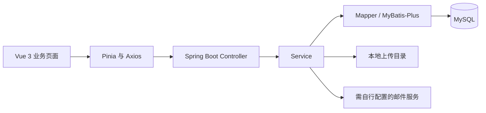

# 智慧养老服务中心

面向养老机构日常工作的课程团队项目，围绕入住、床位、护理、膳食与体检，将多个业务流程组织到同一套管理界面中。仓库包含 Vue 前端、Spring Boot 后端和脱敏后的数据库结构，适合阅读业务模块划分、接口组织与关系数据建模。

**课程团队作品；项目负责人 / 维护者：迟凡杰。** 项目由团队共同完成，本页不将团队或第三方代码归为个人独立成果；具体个人负责模块尚未逐项整理。

[业务页面](frontend/src/view/) · [后端接口](backend/src/main/java/edu/ysu/backend/controller/) · [数据库结构](backend/database/schema.sql) · [后端配置示例](backend/src/main/resources/application-dev.example.yml)

## 功能导航

以下是源码中已有的页面与接口范围，不代表公开版本已全部联调通过。

| 模块 | 页面与实现入口 |
| --- | --- |
| 入住与客户档案 | 入住、退住、外出登记、客户信息；`frontend/src/view/stay/` |
| 床位管理 | 床位列表与楼层示意；`frontend/src/view/bed/` |
| 护理服务 | 护理级别、内容与记录；`frontend/src/view/nurse/` |
| 膳食服务 | 膳食管理、日记和统计；`frontend/src/view/meal/` |
| 健康与体检 | 健康档案、医院/医生、套餐预约与报告；`view/file/`、`view/tijian/` |
| 账户与权限 | 登录、注册、验证码、用户/角色页面；`view/welcome/`、`view/system/` |

后端控制器位于 `backend/src/main/java/edu/ysu/backend/controller/`，例如 `WelcomeController`、`BedController`、`NurseController` 与 `MealController`。

## 技术结构

- 前端：Vue 3、Vite 5、Vue Router、Pinia、Element Plus、Naive UI、Axios、ECharts。
- 后端：Java 8、Spring Boot 2.6.13、MyBatis / MyBatis-Plus、MySQL、JWT、JavaMail。
- 辅助能力：EasyExcel、Knife4j、Hutool。



```text
frontend/src/view/       业务页面、抽屉与表单组件
frontend/src/api/        按业务模块组织的请求函数
frontend/src/stores/     应用状态及合成占位数据
backend/src/main/java/   Controller / Service / Mapper / Entity
backend/src/main/resources/mapper/  SQL 映射
backend/database/schema.sql        28 张表的结构
backend/database/seed.example.sql  空事务示例，不创建账号
```

## 本地准备与启动入口

公开版本没有开箱即用的账号、业务数据或完整媒体包。本次整理未安装依赖、构建或执行端到端测试，下面给出工程入口与必要配置。

### 前端

使用兼容 Vite 5 的 Node.js 环境和 pnpm，在 `frontend/` 中执行：

```sh
pnpm install
pnpm dev
# 构建入口：pnpm build
```

启动前将 `.env.example` 复制为 `.env.local`，用 `VITE_API_BASE_URL` 指向自己控制的后端，例如 `http://127.0.0.1:8080`。示例中的 `/api` 需要自行提供反向代理；当前 `vite.config.js` 没有配置该代理。浏览器访问开发服务器实际打印的地址。

### 后端与数据库

1. 准备 Java 8、Maven 和本机 MySQL，在专用空数据库中导入 `backend/database/schema.sql`。
2. 复制 `src/main/resources/application-dev.example.yml` 为同目录的 `application-dev.yml`，设置 `SPRING_PROFILES_ACTIVE=dev`。
3. 在 IDE 的运行环境中提供下面的变量，导入 Maven 工程，运行 `edu.ysu.backend.BackendApplication`。

| 环境变量 | 用途 |
| --- | --- |
| `DB_URL`、`DB_USERNAME`、`DB_PASSWORD` | 自己的数据库连接与账号 |
| `JWT_SECRET` | 自行生成的签名密钥，不能提交到仓库 |
| `UPLOAD_ROOT` | 本机可写的上传目录 |
| `MAIL_USERNAME`、`MAIL_PASSWORD` | 自己的邮件凭据；Spring Mail 主机、端口等参数也需按服务补全 |

`backend/pom.xml` 的 Spring Boot 插件保留了 `skip=true`，因此这里使用 IDE 主类入口，不承诺 `mvn package` 生成可直接执行的包。`seed.example.sql` 不提供默认账号；登录、角色与菜单等演示数据需另行准备合成数据。

## 当前版本的边界

- 未保留原始客户、健康、联系方式和数据库行数据；`src/stores/temp/` 是结构占位数据。
- 部分图片、媒体和实际上传文件未归档，相关页面可能缺少资源；仓库暂无经过核验的运行截图。
- 语音合成接口为禁用的代理占位实现，不包含可用第三方凭据。
- 多批课程模块与依赖声明仍保留原状，页面或接口存在不等于业务已完整联通。

## 团队与来源

负责人信息表示项目维护与团队组织角色，个人贡献应以实际分工和提交记录为依据。前后端分别保留原有 [前端 MIT License](frontend/LICENSE) 与 [后端 MIT License](backend/LICENSE)，原始声明为 `Copyright (c) 2024 SSymbol`。第三方库继续遵循各自许可证，此处未改写来源署名或新增覆盖全部素材的统一授权。
